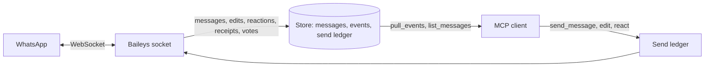
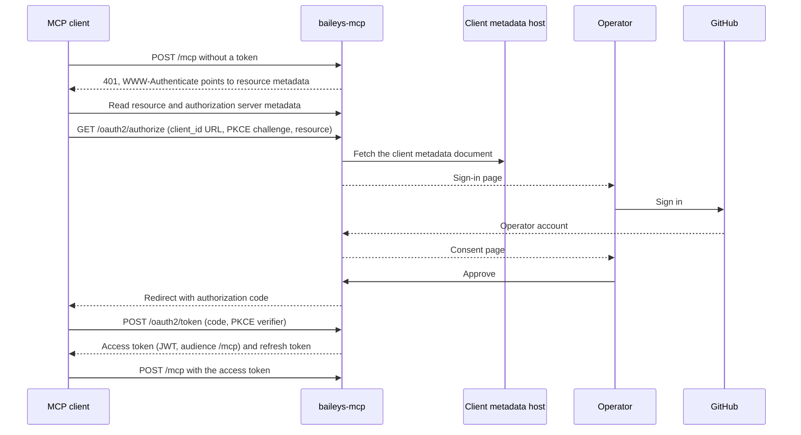

# baileys-mcp specification

## Problem

Baileys is a WhatsApp Web client library. An application that uses it must hold the WhatsApp socket in its own process, persist the Signal credentials, decrypt edits and poll votes, keep sent messages for retry requests, and map LID identities to phone numbers. An AI agent such as Grok Bot cannot embed a library at all. It reaches tools over MCP.

## Solution

baileys-mcp holds the Baileys connection for one WhatsApp account and exposes it as a small set of MCP tools over Streamable HTTP. The server stores every message and every inbound event as Baileys emits them, so a client reads them later through a cursor and never needs to hold a socket.

**Primary outcome:** An embedding application (an application that calls Baileys directly today) can delete its Baileys code and keep the same WhatsApp behavior through these tools. An AI agent can read and send WhatsApp messages across DMs and groups through the same tools.

## Clients

- **Embedding application.** A long-running service. It needs every Baileys capability in [Capability coverage](#capability-coverage). It reads inbound events continuously and reacts within about one second.
- **Grok Bot.** A cloud agent. It adds a custom MCP server by HTTPS URL, authenticates only through OAuth, and can run scheduled routines. It has no safe place to enter a secret header. It is unknown whether it keeps an MCP session open or acts on server notifications, so the surface does not depend on either.

## Domain model

```ts
type Jid = string; // device suffix removed: 5215512345678@s.whatsapp.net, 123456789@lid, 120363000000000000@g.us
type ChatRef = Jid | string; // a JID, or an E.164 phone number such as "+5215512345678"

interface Participant {
  jid: Jid; // phone JID when known, otherwise LID JID
  phone_jid: Jid | null;
  lid_jid: Jid | null;
  name: string | null; // WhatsApp push name
}

interface MessageRef {
  chat: Jid;
  id: string; // WhatsApp message id
}

interface Message {
  chat: Jid;
  chat_kind: 'dm' | 'group';
  id: string;
  from_me: boolean;
  sender: Participant;
  timestamp: string; // ISO 8601
  type:
    | 'text'
    | 'image'
    | 'video'
    | 'gif'
    | 'audio'
    | 'voice'
    | 'document'
    | 'sticker'
    | 'location'
    | 'live_location'
    | 'contacts'
    | 'poll'
    | 'unsupported';
  text: string | null; // body, caption, or location comment
  media: {
    media_id: string;
    mime_type: string;
    size_bytes: number | null;
    file_name: string | null;
    duration_s: number | null;
    is_animated: boolean | null;
  } | null;
  location: { latitude: number; longitude: number; name: string | null; address: string | null } | null;
  contacts: { display_name: string; vcard: string }[] | null;
  poll: { question: string; options: string[]; selectable_count: number } | null;
  reply_to: { id: string; participant: Jid | null } | null;
  mentions: Jid[];
  edited_at: string | null;
  deleted_at: string | null;
}

interface Event {
  cursor: number; // monotonic, assigned in the order the server records events
  at: string;
  type:
    | 'message'
    | 'message_edited'
    | 'message_deleted'
    | 'reaction'
    | 'receipt'
    | 'poll_vote'
    | 'identity_mapped'
    | 'connection';
  // plus the payload for the type, see REQ-EVT-*
}
```

The server keeps five kinds of durable state: the Baileys credentials, the stored messages (with the raw protocol data that later decryption and retries need), the event log, the send ledger (idempotency key to WhatsApp message id and outcome), and the OAuth state (registered clients, consents, refresh tokens, and the operator session). Downloaded media is a cache that the server can rebuild from the stored messages.



## Tools

Every tool declares a zod input schema and an output schema and returns structured content. A failed call returns an error result whose content is `{ code, message, retryable }`.

| Tool               | Hints             | Purpose                                                                 |
| ------------------ | ----------------- | ----------------------------------------------------------------------- |
| `get_status`       | read-only         | Connection state, own account identity, pairing data, event cursor head |
| `pair`             | write             | Start QR pairing or request a pairing code                              |
| `list_chats`       | read-only         | Groups the account is in and DMs with stored messages                   |
| `list_messages`    | read-only         | Stored messages of one chat                                             |
| `pull_events`      | read-only         | Inbound events after a cursor, with long polling                        |
| `download_media`   | read-only         | Media bytes of one stored message                                       |
| `send_message`     | write             | Text, media, location, or poll, with optional reply and mentions        |
| `edit_message`     | write             | Edit a message the account sent                                         |
| `react_to_message` | write, idempotent | Set or remove the account's reaction                                    |
| `mark_read`        | write, idempotent | Send read receipts                                                      |
| `set_typing`       | write, idempotent | Show or stop the typing indicator                                       |

Error codes: `not_paired`, `not_connected`, `unknown_chat`, `unknown_message`, `invalid_recipient`, `not_on_whatsapp`, `media_too_large`, `unsupported_media`, `media_unavailable`, `send_in_progress`, `send_ambiguous`, `invalid_cursor`, `pairing_not_allowed`.

## Requirements

### Endpoint and authentication

The server is its own OAuth authorization server and the protected resource, following the MCP authorization specification. Clients add it with no headers and choose Authorize. Better Auth's [MCP plugin](https://better-auth.com/docs/plugins/mcp) provides the authorization server, the discovery documents, and the token check on `/mcp`.



The authorization endpoints are `/oauth2/authorize`, `/oauth2/token`, and, for dynamic registration, `/oauth2/register`, under Better Auth's base path. Clients find them through the discovery documents, so the paths are not part of the contract.

- **REQ-AUTH-001** The server serves MCP over Streamable HTTP at `/mcp`. It also serves the OAuth endpoints, the discovery documents, and the sign-in and consent pages. Every other path returns 404.
- **REQ-AUTH-002** A request to `/mcp` without a valid access token returns 401 with a `WWW-Authenticate` header that points to the protected resource metadata. No tool runs for a rejected request.
- **REQ-AUTH-003** The server publishes OAuth protected resource metadata (RFC 9728) for `/mcp` and authorization server metadata (RFC 8414).
- **REQ-AUTH-004** Clients get tokens through the authorization code flow with PKCE (S256). The server accepts a client that identifies itself with a client ID metadata document, and a client that registers dynamically. Both paths accept custom-scheme callbacks such as `cursor://anysphere.cursor-mcp/oauth/callback`.
- **REQ-AUTH-005** Only the configured operator account can sign in. A sign-in with any other account fails and creates no session.
- **REQ-AUTH-006** The operator approves each client on a consent page before the server issues an authorization code.
- **REQ-AUTH-007** Access tokens are signed JWTs whose audience is the `/mcp` resource. The server checks the signature, issuer, audience, and expiry on every request. A client renews its access with a refresh token, without a new sign-in.
- **REQ-AUTH-008** The embedding application, a headless service, gets its tokens with the client credentials grant as a pre-registered confidential client.
- **REQ-AUTH-009** The server accepts MCP requests that omit the `MCP-Protocol-Version` header. Grok Bot omits it when it reuses a session.
- **REQ-AUTH-010** The server does not start without its signing secret, its public base URL, and the operator account configuration.
- **REQ-AUTH-011** A client whose `client_id` is an HTTPS URL is accepted without registration. The server fetches the metadata document at that URL over HTTPS only. It resolves the host once, rejects special-use addresses (RFC 6890), refuses redirects, and stops after 5 s or 5 KB.
- **REQ-AUTH-012** Dynamic registration needs no prior authentication. Each client IP address can register at most 5 clients per minute and make at most 20 token requests per minute.
- **REQ-AUTH-013** The `/mcp` resource requires the scope `whatsapp`. A token without it gets 403 with an `insufficient_scope` challenge. A client that also requests `offline_access` receives a refresh token.
- **REQ-AUTH-014** The consent page shows the client's name and the requested scopes. It renders only for an authorization request whose signed query parameters verify.
- **REQ-AUTH-015** Each refresh issues a new refresh token. The previous refresh token stays valid for 30 s, so a client that retries a refresh does not lose access.
- **REQ-AUTH-016** When an access token is DPoP-bound (RFC 9449), every request with it must carry a valid DPoP proof.

### Connection and pairing

- **REQ-CONN-001** The server holds one Baileys connection for one account. The credentials survive a restart.
- **REQ-CONN-002** With no stored credentials, the server starts QR pairing. `get_status` returns the current QR string while pairing.
- **REQ-CONN-003** `pair({ method: 'code', phone_number })` returns a pairing code for the operator to enter on the phone. `pair({ method: 'qr' })` restarts QR pairing.
- **REQ-CONN-004** `pair` returns `pairing_not_allowed` while the state is `open`.
- **REQ-CONN-005** When WhatsApp logs the account out, the server stops reconnecting and reports `logged_out`. It keeps the credentials until a `pair` call replaces them.
- **REQ-CONN-006** After any other disconnect, the server reconnects with exponential backoff: 1 s base, 30 s cap, random jitter. A close with code 440 (another connection replaced this one) reports the state `replaced`. Every other reconnect reports `reconnecting`.
- **REQ-CONN-007** `get_status` works in every state. It returns `state` (`pairing`, `connecting`, `open`, `reconnecting`, `replaced`, `logged_out`, or `closed`), the account's phone JID and LID JID, the last disconnect code and time, the pairing data, and the newest event cursor.
- **REQ-CONN-008** The server does not mark the account online when it connects, and it does not request a full history sync.

### Inbound events

- **REQ-EVT-001** The server records each inbound fact in the event log when Baileys emits it, whether or not a client is connected.
- **REQ-EVT-002** `pull_events({ after })` returns the events after the cursor `after` in log order. It returns at most `limit` events (default 100, maximum 500), the cursor `next`, and `has_more`.
- **REQ-EVT-003** `pull_events({ since })` starts at the first event recorded at or after the ISO time `since`. A client that keeps no cursor uses it.
- **REQ-EVT-004** When `wait_ms` is greater than 0 and no event matches, `pull_events` returns as soon as a matching event is recorded. If none arrives within `wait_ms` (maximum 25 000), it returns an empty list.
- **REQ-EVT-005** `pull_events` filters by event `types` and by `chats` when the client gives them.
- **REQ-EVT-006** A cursor older than the retained log returns `invalid_cursor` with `oldest_available`.
- **REQ-EVT-007** A new message, from another participant or from the account itself on any linked device, produces one `message` event with the normalized `Message`. A message that Baileys emits more than once produces one event.
- **REQ-EVT-008** An edit produces `message_edited` with the target `MessageRef`, the new text, the editor, and the time. This applies to plain participant edits, encrypted participant edits (`secretEncryptedMessage`), and edits the account makes. The server decrypts encrypted edits with the original message's secret.
- **REQ-EVT-009** A delete for everyone produces `message_deleted` with the target `MessageRef`, the deleter, and the time.
- **REQ-EVT-010** A reaction produces `reaction` with the target, the reactor, and the emoji. A removed reaction carries `emoji: null`.
- **REQ-EVT-011** A poll vote produces `poll_vote` with the poll `MessageRef`, the voter, and the selected option names. The server decrypts the vote with the poll's secret.
- **REQ-EVT-012** A delivery, read, or played receipt, and a server acknowledgement of a sent message, produce `receipt` with the target, the participant (null for a server acknowledgement), and `state` (`server_ack`, `delivered`, `read`, or `played`).
- **REQ-EVT-013** When the server learns a LID-to-phone pair, it produces `identity_mapped` with both JIDs.
- **REQ-EVT-014** Every connection state change produces `connection` with the new state and the last disconnect.

### Reading

- **REQ-READ-001** `list_chats({ kind?, limit? })` returns the groups the account participates in and the DMs that have at least one stored message. Each chat carries its JID, kind, name, and the time of its last stored message. `limit` defaults to 100, maximum 500.
- **REQ-READ-002** `list_messages({ chat, since?, before?, limit? })` returns stored messages of one chat, newest first, with `has_more`. `limit` defaults to 50, maximum 200. Deleted messages appear with `deleted_at` set.
- **REQ-READ-003** The server normalizes each WhatsApp message to `Message`. It unwraps ephemeral and document-with-caption wrappers. It reports a voice note as `voice`, a GIF video as `gif`, and any content it does not recognize as `unsupported`.

### Media

- **REQ-MEDIA-001** `download_media({ media_id })` returns the bytes of a stored message's media as an MCP `image` block for `image/*`, an `audio` block for `audio/*`, and an embedded blob resource for any other type.
- **REQ-MEDIA-002** Media larger than 10 MiB returns `media_too_large` with its size.
- **REQ-MEDIA-003** When WhatsApp no longer holds the media, the server asks the sender's phone to upload it again. If the media still cannot be downloaded, the tool returns `media_unavailable`.
- **REQ-MEDIA-004** `send_message` takes media as `{ base64, mime_type }` of at most 10 MiB decoded, or as `{ media_id }` of media the server already stores.

### Sending

- **REQ-SEND-001** `send_message({ to, idempotency_key, content, reply_to?, mentions? })` sends one of these content types: `text`, `image`, `video`, `gif`, `audio`, `voice`, `document`, `sticker`, `location`, or `poll`. Media types take an optional caption. `document` also takes a file name.
- **REQ-SEND-002** Text has 1 to 4 096 characters. A poll has 2 to 12 unique options and a `selectable_count` from 1 to the number of options. A sticker must be `image/webp`. A voice note must be `audio/ogg; codecs=opus`.
- **REQ-SEND-003** `to` accepts a group JID, a phone JID, a LID JID, or an E.164 number. The server resolves a number through WhatsApp and returns `not_on_whatsapp` for a number that has no account.
- **REQ-SEND-004** `reply_to` must name a stored message. The server builds the quoted message from its store.
- **REQ-SEND-005** `send_message`, `edit_message`, and `react_to_message` require `idempotency_key`. A second call with a key the server has seen returns the first outcome and sends nothing.
- **REQ-SEND-006** The server chooses the WhatsApp message id and records it with the key before it sends. The result returns the id.
- **REQ-SEND-007** When a send does not finish within 60 s, the result is `status: 'ambiguous'` with the message id. The server ends the socket and reconnects. It does not send the message again. A later call with the same key returns `send_ambiguous` until a `receipt` for that id arrives, and `sent` after it.
- **REQ-SEND-008** When the server is not connected, a send returns `not_connected` and nothing reaches WhatsApp. A retry with the same key may send.
- **REQ-SEND-009** `edit_message({ target, text, idempotency_key })` edits only a message the account sent. Any other target returns `unknown_message`.
- **REQ-SEND-010** `react_to_message({ target, emoji, idempotency_key })` sets the account's reaction to one emoji. `emoji: null` removes it.
- **REQ-SEND-011** `mark_read({ targets })` sends read receipts for 1 to 100 stored messages. The server never sends a read receipt on its own.
- **REQ-SEND-012** `set_typing({ chat, state, ttl_s? })` with `composing` shows the typing indicator and refreshes it every 10 s. It stops on `paused`, on a send to that chat, or after `ttl_s` (default 60, maximum 300).
- **REQ-SEND-013** The server generates and stores each poll's secret. No tool returns it.

### Identity

- **REQ-ID-001** Every participant carries `jid`, `phone_jid`, `lid_jid`, and `name`. `jid` is the phone JID when the server knows it, and the LID JID otherwise. Device suffixes are removed.
- **REQ-ID-002** Every tool input that names a chat or participant accepts either the phone JID or the LID JID.

### Storage

- **REQ-STORE-001** Stored messages, the event log, and the send ledger survive a restart.
- **REQ-STORE-002** The server deletes messages and events older than the retention period (default 30 days, configurable) and send ledger entries older than 7 days.
- **REQ-STORE-003** When a recipient asks for a retry of a message the account sent, Baileys requests the message from the server and the server returns it from its store.
- **REQ-STORE-004** The OAuth state (clients, consents, tokens, and signing keys) lives in the same durable store and survives a restart. Its tables change only through committed migrations.

## Invariants

- The server holds at most one Baileys connection. A second process with the same credentials is an operator error that shows as the `replaced` state.
- The server records an inbound fact before any tool can return it.
- Cursors only grow. `pull_events` returns events in the order the server recorded them.
- A send with a given idempotency key reaches WhatsApp at most once.
- The server never resends a message whose outcome is ambiguous.
- No tool unlinks a working account.
- No tool runs for a request without a valid access token.
- Only the operator account can authorize a client.
- No tool result or log line contains credentials, message secrets, or poll secrets. Logs contain no message content.
- No log line contains an access token, a refresh token, an authorization code, or a client secret.
- The server sends read receipts and typing indicators only when a client asks.

## Capability coverage

Each Baileys capability that an embedding application needs, and the part of this server that provides it.

| Baileys capability                                                                                        | Provided by                                                             |
| --------------------------------------------------------------------------------------------------------- | ----------------------------------------------------------------------- |
| Multi-file auth state, `creds.update`                                                                     | Internal credential store (REQ-CONN-001)                                |
| QR from `connection.update`                                                                               | `get_status`, `pair` (REQ-CONN-002, 003)                                |
| Pairing code (`requestPairingCode`)                                                                       | `pair` (REQ-CONN-003)                                                   |
| Connection open, close, logged out, reconnect                                                             | `connection` event, `get_status` (REQ-CONN-005 to 007, REQ-EVT-014)     |
| Own identity `socket.user.id` and `lid`                                                                   | `get_status` (REQ-CONN-007)                                             |
| `getMessage` for retry requests                                                                           | Internal (REQ-STORE-003)                                                |
| `messages.upsert`                                                                                         | `message` event (REQ-EVT-007)                                           |
| Edits from `messages.upsert` and `messages.update`, including `secretEncryptedMessage`                    | `message_edited` event (REQ-EVT-008)                                    |
| Deletes (`messageStubType` REVOKE)                                                                        | `message_deleted` event (REQ-EVT-009)                                   |
| `messages.reaction`                                                                                       | `reaction` event (REQ-EVT-010)                                          |
| Poll votes (`decryptPollVote`)                                                                            | `poll_vote` event (REQ-EVT-011)                                         |
| `message-receipt.update`, status in `messages.update`                                                     | `receipt` event (REQ-EVT-012)                                           |
| LID mapping (`getLIDForPN`, `getPNForLID`, `lid-mapping.update`)                                          | `Participant` fields, `identity_mapped` event (REQ-ID-001, REQ-EVT-013) |
| `downloadMediaMessage` with media re-upload                                                               | `download_media` (REQ-MEDIA-001 to 003)                                 |
| `groupFetchAllParticipating`                                                                              | `list_chats` (REQ-READ-001)                                             |
| `sendMessage` text, image, video, GIF, audio, voice, document, sticker, location, poll, with quoted reply | `send_message` (REQ-SEND-001 to 004)                                    |
| `sendMessage` edit                                                                                        | `edit_message` (REQ-SEND-009)                                           |
| `sendMessage` react                                                                                       | `react_to_message` (REQ-SEND-010)                                       |
| `readMessages`                                                                                            | `mark_read` (REQ-SEND-011)                                              |
| `sendPresenceUpdate` composing and paused                                                                 | `set_typing` (REQ-SEND-012)                                             |
| Send timeout handling                                                                                     | Send ledger (REQ-SEND-005 to 008)                                       |

## Non-goals

- History sync and backfill of messages from before the server started recording
- Group management: create, add or remove members, admin rights, subject
- Contact lists, profile pictures, status updates, newsletters, calls, and block lists
- Deleting messages for everyone, forwarding, and pinning
- Fetching media from a URL
- Media items larger than 10 MiB, streaming, and a separate HTTP endpoint for media bytes
- Server-initiated notifications and webhooks
- More than one WhatsApp account per server process
- User accounts and sign-in for anyone other than the operator
- Static API keys and secret headers
- Revoking a client's access

## Decisions

| ID      | Status                  | Decision                                                                                                                                                                                                                                                                                                                                                                                     |
| ------- | ----------------------- | -------------------------------------------------------------------------------------------------------------------------------------------------------------------------------------------------------------------------------------------------------------------------------------------------------------------------------------------------------------------------------------------- |
| DEC-001 | ratified                | The server uses `@modelcontextprotocol/sdk` and defines every tool schema with `zod`.                                                                                                                                                                                                                                                                                                        |
| DEC-002 | provisional, 2026-10-22 | Pull with a client-owned cursor and long polling is the only event path in v1. The SDK drops a notification in stateless mode when no client stream is open, and no client is known to keep one open.                                                                                                                                                                                        |
| DEC-003 | provisional, 2026-10-22 | Media travels as base64 inside MCP content blocks, up to 10 MiB per item. The MCP content types are text, image, audio, resource link, and embedded resource, so video and documents travel as embedded blob resources.                                                                                                                                                                      |
| DEC-004 | provisional, 2026-10-22 | Every write requires an idempotency key. The server fixes the WhatsApp message id before it sends, which Baileys supports through the `messageId` send option.                                                                                                                                                                                                                               |
| DEC-005 | provisional, 2026-10-22 | Pairing returns the raw QR string and supports pairing codes. The server does not render QR images in v1.                                                                                                                                                                                                                                                                                    |
| DEC-006 | ratified, 2026-10-22    | Authentication is OAuth through Better Auth: `better-auth` with the `@better-auth/mcp` and `@better-auth/cimd` plugins. Grok Bot connectors authenticate only through OAuth ([Cursor forum, 2026-09-17](https://forum.cursor.com/t/grok-bot-custom-mcp-oauth-fails-before-sign-in-redirect-uri-not-allowed/171877)). `@better-auth/mcp` does not depend on an MCP SDK, so DEC-001 holds.     |
| DEC-007 | provisional, 2026-10-22 | v1 leaves out URL media sources (the server would fetch any URL a client names), deleting for everyone, and group member lookup, because no client needs them yet.                                                                                                                                                                                                                           |
| DEC-008 | provisional, 2026-10-22 | The operator signs in with GitHub, and the server accepts only the GitHub account it is configured with. The server stores no operator password.                                                                                                                                                                                                                                             |
| DEC-009 | provisional, 2026-10-22 | The server supports both client ID metadata documents and dynamic registration. Grok Bot used dynamic registration in September 2026 and a client ID metadata document (`https://cursor.com/oauth/mcp-client.json`) in October 2026. Anyone can register a client, but no client gets a token without the operator's sign-in and consent.                                                    |
| DEC-010 | provisional, 2026-10-22 | The server composes Better Auth's `jwt()`, `mcp()`, and `cimd()` plugins and no separate `oauthProvider()`, as the MCP plugin page requires. `cimd()` uses the Node fetch transport from `@better-auth/cimd/node` and the `mcp-2026-07-28` metadata profile. The rate limits, the 30 s refresh overlap, and the metadata fetch limits in REQ-AUTH-011, 012, and 015 are the plugin defaults. |
| DEC-011 | provisional, 2026-10-22 | One scope, `whatsapp`, grants every tool. A split into read and send scopes waits until a client needs read-only access.                                                                                                                                                                                                                                                                     |
| DEC-012 | ratified, 2026-10-22    | Access and refresh tokens use the MCP plugin's default lifetimes.                                                                                                                                                                                                                                                                                                                            |
| DEC-013 | ratified, 2026-10-22    | v1 has no automated tests, because no WhatsApp account is available to test against. `npm run verify` and scripted runs against the assembled server check each change. Behavior that needs a paired account is checked by hand after pairing.                                                                                                                                               |
| DEC-014 | provisional, 2026-10-22 | The MCP plugin keeps the base plugin's grant types, which include client credentials, so the embedding application uses that grant (REQ-AUTH-008).                                                                                                                                                                                                                                           |

## Risks

- **Security boundary.** A public endpoint that can read and send as a WhatsApp account, and an OAuth authorization server with open client registration. A leaked access or refresh token gives full access to that account until it expires, because v1 has no revocation.
- **Public API contract.** The tool names and schemas are a contract for agents and for embedding applications.
- **Persistent data.** The store holds message content and credentials. A store schema change needs a migration.
- **Infrastructure.** The server needs a persistent volume and exactly one replica.
- **Unofficial client.** WhatsApp can change its protocol or restrict an account that uses Baileys.

## Acceptance criteria

- [ ] Smallest working proof: an MCP client pairs the server with a pairing code, sends a text to a group, and receives the reply through `pull_events` with `wait_ms`.
- [ ] Grok Bot adds the server with no headers. The operator chooses Authorize, signs in with GitHub, and approves the consent page. Grok Bot then calls `get_status`.
- [ ] A request to `/mcp` without a token returns 401 with the resource metadata pointer, and a sign-in with a GitHub account other than the operator's fails.
- [ ] The embedding application gets a token with the client credentials grant and calls `pull_events`.
- [ ] A client whose `client_id` URL resolves to a private address is rejected, and the server makes no request to that address.
- [ ] A token without the `whatsapp` scope gets 403. A client keeps working through a refresh after its access token expires.
- [ ] After a restart, the server reconnects without pairing again, and `pull_events` continues from the cursor the client held.
- [ ] Two `send_message` calls with the same idempotency key produce one WhatsApp message and the same result.
- [ ] A send that times out returns `ambiguous` with the message id and is not sent again.
- [ ] A participant's encrypted edit, a delete, a reaction, a poll vote, and a read receipt each produce their event with decrypted content.
- [ ] `download_media` returns a received photo, voice note, video, and document, each in the block type REQ-MEDIA-001 names.
- [ ] `send_message` delivers each content type in REQ-SEND-001, as a reply when `reply_to` is given.
- [ ] A message from a LID-only participant carries the phone JID once the server learns the mapping, and an `identity_mapped` event follows.
- [ ] Every row in [Capability coverage](#capability-coverage) has been exercised through its tool against a paired account.

## Later questions

- Does Grok Bot keep an MCP session open between calls, or act on server notifications? A yes makes a wake-up notification worth adding.
- What is Grok Bot's largest tool result, and does it display image, audio, and blob blocks? The answer sets the inline media limit.
- What are WhatsApp's upload limits per media type? Until then the server returns the WhatsApp error as it is.
- Which `messages.update` status marks an ambiguous send as received? `SERVER_ACK` (2) is the likely value.
- Should sends be limited to a configured list of chats, so a leaked token reaches fewer people?
- Is 30 days the right retention for stored messages?
